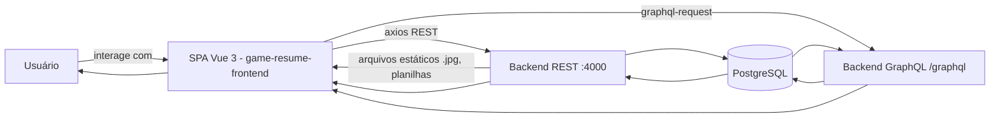
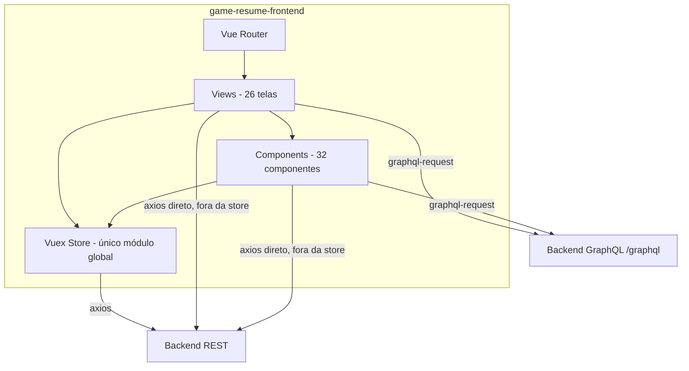

# SPECIFICATION.md — game-resume-frontend

> Documento gerado por engenharia reversa do código-fonte do repositório `game-resume-frontend` (SPA Vue 3), seguindo o template de Specification-Driven Development definido em `Você é um Arquiteto de Software.md` / `Specification-Driven Development.pdf`. Escopo: **frontend**. Seções de responsabilidade exclusiva do backend são marcadas como "Não Aplicável ao frontend" com link para `D:\Packsys\NetBeansProjects\game-resume-backend\SPECIFICATION.md` (doravante "SPECIFICATION.md do backend"). Toda referência `arquivo:linha` aponta para o estado do código-fonte na data de geração deste documento (ver [24. Histórico de Versões](#24-histórico-de-versões)).

## Índice

1. [Visão Geral do Sistema](#1-visão-geral-do-sistema)
2. [Arquitetura](#2-arquitetura)
3. [Regras de Negócio](#3-regras-de-negócio)
4. [Casos de Uso](#4-casos-de-uso)
5. [Modelo de Domínio](#5-modelo-de-domínio)
6. [Banco de Dados](#6-banco-de-dados)
7. [APIs](#7-apis)
8. [Telas](#8-telas)
9. [Segurança](#9-segurança)
10. [Integrações](#10-integrações)
11. [Processos Assíncronos](#11-processos-assíncronos)
12. [Configurações](#12-configurações)
13. [Logs e Auditoria](#13-logs-e-auditoria)
14. [Requisitos Funcionais](#14-requisitos-funcionais)
15. [Requisitos Não Funcionais](#15-requisitos-não-funcionais)
16. [Critérios de Aceitação](#16-critérios-de-aceitação)
17. [Testes](#17-testes)
18. [Observabilidade](#18-observabilidade)
19. [Dívida Técnica](#19-dívida-técnica)
20. [Roadmap de Modernização](#20-roadmap-de-modernização)
21. [Matriz de Rastreabilidade](#21-matriz-de-rastreabilidade)
22. [Glossário](#22-glossário)
23. [Anexos](#23-anexos)
24. [Histórico de Versões](#24-histórico-de-versões)
25. [Aprovações](#25-aprovações)

---

## 1. Visão Geral do Sistema

### 1.1 Objetivo

O `game-resume-frontend` é a interface web (SPA) de um sistema pessoal de catalogação e acompanhamento de uma coleção de jogos eletrônicos multiplataforma ("Games Resume" — título exibido em `src/components/Nav.vue:6`). Permite ao usuário listar, cadastrar, editar, excluir e marcar como concluído/jogando jogos possuídos em 10 plataformas (Origin, Ubisoft, Steam, Wii, WiiU, GameCube, PC, Console genérico, VirtualConsole, ToBuy/"a comprar"), gerenciar DLCs e códigos/dicas, importar um acervo em massa via planilha XLSX, consultar estatísticas/gráficos de progresso e restaurar itens de uma lixeira (soft delete).

### Problema de negócio

Sem esta ferramenta, o controle de uma coleção de jogos espalhada por múltiplas plataformas físicas e digitais (Steam, Origin, Ubisoft Connect, consoles Nintendo, mídia física) é feito manualmente (planilhas, memória), dificultando saber o que já foi concluído, o que falta comprar, quais DLCs existem para um jogo e obter uma visão consolidada de progresso por sistema.

### Público-alvo

Usuário único, dono da coleção. O frontend não implementa nenhuma tela de login, seleção de perfil, ou diferenciação de papéis — toda a interface assume um único usuário operando o sistema (ver [AMB-F-001](#9-segurança) para a lacuna de autenticação correspondente).

### Benefícios

- Visão consolidada de toda a coleção, por plataforma e agregada ("All Games").
- Acompanhamento de progresso (jogos concluídos/não concluídos), inclusive por sistema (`/finished_over_system`).
- Importação em massa via planilha XLSX, evitando cadastro manual jogo a jogo.
- Exportação do acervo em CSV, PDF e XLS por plataforma.
- Gestão de dicas/códigos de jogos com editor de texto rico (Quill).
- Estatísticas e gráficos (barra e pizza) de totais e percentuais de conclusão.
- Recuperação de itens excluídos por engano via tela de Lixeira (`/trash`).

### 1.2 Escopo

**Incluído**
- Listagem, criação, edição e exclusão de jogos por plataforma (10 tabelas de plataforma + agregados).
- Marcação de jogo como concluído/não concluído (toggle) e como "jogando agora".
- Gestão de DLCs (listagem e marcação de conclusão) para Steam/Wii/WiiU/GameCube.
- Importação de planilha XLSX de jogos.
- Exportação de dados em CSV/PDF/XLS (via link direto para o backend).
- Busca de jogos por título e por gênero.
- Filtro local (client-side) por título dentro de uma tabela.
- Gestão de códigos/dicas por jogo (criação/edição de conteúdo rico).
- Consulta de estatísticas e gráficos (resumo, por sistema, por gênero).
- Lixeira: listagem, restauração e exclusão definitiva de itens removidos.

**Não Incluído** (no frontend, apesar de aparecer no template)
- Autenticação/login de usuário, gestão de sessão, token — **não implementado** (ver [AMB-F-001](#9-segurança)).
- Paginação de listagens — todas as listagens carregam o conjunto completo retornado pelo backend.
- Testes automatizados (unitários, integração ou E2E) — nenhum presente no repositório (ver [17. Testes](#17-testes)).
- Internacionalização — toda a interface está em inglês, independentemente de localidade.
- Qualquer lógica de banco de dados, regra de negócio server-side ou infraestrutura — documentadas em `SPECIFICATION.md` do backend.

### 1.3 Fluxo Geral



### Contexto corporativo

Projeto pessoal/hobby ("games resume"), sem indicação de uso corporativo, SLA, multi-tenant ou processo formal de CI/CD no repositório (nenhum workflow de CI versionado, nenhum pipeline de deploy documentado). Mantido como um monorepo lógico de dois repositórios irmãos (frontend e backend) com documentação própria em cada um.

### Sistemas integrados

| Sistema | Natureza da integração | Consumido diretamente pelo frontend? |
|---|---|---|
| `game-resume-backend` (REST + GraphQL, porta padrão 4000) | Toda persistência e regra de negócio de domínio | Sim — única integração direta do frontend |
| Steam Web API | Sincronização de biblioteca Steam | Não — acionado apenas pelo backend (`GET /steam_api`, `POST /sync_steam`); o frontend não chama a Steam diretamente nem expõe tela dedicada a disparar a sincronização |
| Gmail/Nodemailer | Envio de relatório por e-mail | Não — acionado apenas pelo backend (`POST /mail`); nenhuma tela do frontend aciona este endpoint |

> **AMBIGUIDADE (AMB-F-003)** O backend expõe `POST /sync_steam` (UC-008, sincronizar biblioteca com Steam) e `POST /mail` (UC-010, enviar relatório por e-mail), mas nenhuma tela ou chamada do frontend (`grep -rn "sync_steam\|/mail"` em `src/` sem ocorrências) aciona esses endpoints. Não é possível determinar, apenas pela leitura, se essas funcionalidades foram descontinuadas no frontend, se são operadas por outro meio (ex.: `curl`/Postman manual), ou se é uma lacuna de interface pendente.

---

## 2. Arquitetura

### 2.1 Visão Arquitetural

**Estilo Arquitetural**: SPA (Single Page Application) cliente-servidor, consumindo uma API externa (o backend) por HTTP. Não há backend-for-frontend, não há SSR, não há microsserviços no próprio frontend — é um monólito de apresentação.

**Tecnologias**

| Camada | Tecnologia | Versão (`package.json`) |
|---|---|---|
| Framework UI | Vue | `^3.2.21` |
| Roteamento | vue-router | `^4.0.0-0` |
| Estado global | vuex | `^4.0.0-0` |
| Cliente HTTP (REST) | axios | `^0.24.0` |
| Cliente GraphQL | graphql-request / graphql | `^3.6.1` / `^15.7.2` |
| UI / Estilo | bootstrap | `^5.1.3` |
| Ícones | @fortawesome/fontawesome-free | `^5.15.4` |
| Gráficos | chart.js | `^3.6.0` |
| Editor de texto rico | @vueup/vue-quill | `^1.0.0-beta.8` |
| Notificações (toast) | vue-toastification | `^2.0.0-rc.5` |
| Interações de UI (dropdowns Bootstrap) | @popperjs/core | `^2.10.2` |
| Build / tooling | @vue/cli-service, @vue/compiler-sfc, babel | `~4.5.0` / `^3.0.0` |
| Lint | eslint + eslint-plugin-vue | `^6.7.2` / `^7.0.0` |

Não há camada de persistência, banco de dados ou mensageria no frontend (N/A — ver [6. Banco de Dados](#6-banco-de-dados)).

### 2.2 Diagrama Arquitetural



> **COMPORTAMENTO IMPLÍCITO (IMP-F-001)** Nem toda chamada ao backend passa pela Vuex store: `src/store/index.js` concentra apenas 6 ações (`getGames`, `finishGame`, `deleteGame`, `updateGame`, `saveGame`, `markAsPlaying`), todas REST. Chamadas GraphQL (10 arquivos, ver [10. Integrações](#10-integrações)) e diversas chamadas REST pontuais (`Import.vue`, `Codes.vue`, `Search.vue`, `GamesByGenreSearch.vue`, `FinishedOverSystem.vue`, `TrashTable.vue`, e a feature de DLC em 4 tabelas) são feitas diretamente nos componentes/views via `axios`/`graphql-request`, sem passar pelo estado global nem pela store. Não existe camada de serviço única (`src/services/`, `src/api/` ou equivalente) centralizando acesso a dados — ver [DT-F-002](#19-dívida-técnica).

### 2.3 Estrutura de Módulos

| Módulo | Descrição | Responsabilidades | Dependências |
|---|---|---|---|
| `src/router/` (`index.js`) | Define as 26 rotas da SPA via `vue-router` com `createWebHistory` | Mapeamento URL → componente de view, lazy-loading (`() => import(...)`) de todas as rotas exceto `Home` | `vue-router`, `views/*` |
| `src/store/` (`index.js`) | Único módulo Vuex (`modules: {}` vazio) | Estado global (`hashMap`, `games`, `selectedItem`, `currentIdx`), 6 ações REST, 2 mutations, 3 getters | `vuex`, `axios` |
| `src/views/` | 26 componentes de página, um por rota | Orquestram componentes de tabela/gráfico, disparam carregamento inicial de dados, hospedam modais de criação | `components/*`, `store`, `axios`/`graphql-request` diretamente em vários casos |
| `src/components/` | 32 componentes reutilizáveis | Tabelas de listagem+CRUD por plataforma (10), tabelas agregadas somente-leitura (3: All/Console/PC), tabelas de resultado de busca (2), gráficos (4: 2 barra + 2 pizza), tabelas de totais (3), lixeira (1), layout (`Nav`, `Footer`, `Modal`, `Loading`, `JumboTron`/`JumboDark`/`JumboClear`), e 1 componente não utilizado (`HelloWorld.vue`, ver [DT-F-007](#19-dívida-técnica)) | `vuex`, `axios`, `graphql-request`, `vue-toastification` |
| `src/App.vue` / `src/main.js` | Shell da aplicação | Registra `store`, `router`, `vue-toastification` e importa Bootstrap/FontAwesome globalmente; renderiza `Nav` + `router-view` + `Footer` | `vue`, `bootstrap`, `@fortawesome/fontawesome-free` |

---

## 3. Regras de Negócio

> Prefixo `BR-F-` (Business Rule, Frontend) para não colidir com a numeração `BR-00x` do backend (ver [design.md](openspec/changes/generate-frontend-specification/design.md), decisão D1).

### BR-F-001 — Deduplicação de jogos em memória por `app_id`/`id`

**Descrição**: ao carregar uma lista de jogos, a store reconstrói um `Map` indexado por `app_id` (ou `id`, se `app_id` for falsy), exceto para a tabela `dlcs`, onde a chave é sempre `id`.

**Implementação**: `src/store/index.js:12-26` (mutation `SAVE_GAMES`).

**Processamento**: `tag = payload.isDLC ? game.id : (game.app_id || game.id)`; `state.hashMap.set(tag, game)`; `state.games = Array.from(state.hashMap.values())`.

**Efeito observável**: se a resposta da API contiver dois registros com o mesmo `app_id` (ou `id`, para DLCs), apenas o último sobrescreve o anterior no `Map` — a lista exibida terá menos itens do que os retornados pela API, sem aviso ao usuário.

### BR-F-002 — "Mark as Finished" é um toggle, não uma atribuição fixa

**Descrição**: o botão "Mark as Finished" não define `finished = true` incondicionalmente; ele inverte o valor atual.

**Implementação**: `src/store/index.js:42-66` (action `finishGame`): `finished: !context.state.selectedItem.finished`.

**Efeito observável**: clicar novamente no mesmo botão desfaz a marcação ("Unfinished"); a mensagem de sucesso se adapta dinamicamente (`Success on Mark ${title} as ${!finished ? 'Finished' : 'Unfinished'}`, linha 60).

### BR-F-003 — Payload de atualização varia por tabela de destino

**Descrição**: a ação `updateGame` monta um payload diferente conforme `payload.table`.

**Implementação**: `src/store/index.js:91-150`.

| `table` | Campos enviados |
|---|---|
| `tobuy` | `id, title, finished, system, table, magnetic_link` |
| `virtualconsole` | `id, app_id, system_id, title, finished, genuine, table` |
| `dlcs` | `id, app_id, title, finished, collection, table` |
| qualquer outro (Origin/Ubisoft/Steam/Wii/WiiU/GameCube) | `id, app_id, system_id, title, finished, finished_at, collection, genuine, fisical_disc, table` |

### BR-F-004 — "Mark as Playing" cria um novo registro, não atualiza o jogo de origem

**Descrição**: ao clicar em "Mark as Playing" em qualquer tabela de plataforma, o frontend monta um payload com `table: 'playing'` e o envia para o mesmo endpoint de criação (`POST /create`) usado para cadastrar jogos novos. O registro original do jogo, em sua tabela de origem, **não é alterado**.

**Implementação**: `src/store/index.js:165-185` (action `markAsPlaying`); disparo em `src/components/OriginGamesTable.vue:208-212` (`payload.table = 'playing'`), replicado em todas as demais tabelas de plataforma com esse botão.

**Efeito observável**: o mesmo jogo pode aparecer simultaneamente em sua tabela de plataforma e na tela "Playing" (`/playing`), como dois registros independentes; excluir um não afeta o outro.

### BR-F-005 — Filtro local de busca por título (apenas em 7 das 10+ tabelas)

**Descrição**: as tabelas Steam, Wii, WiiU, GameCube, PC, Console e AllGames possuem um campo de busca client-side que filtra a lista já carregada, sem nova chamada à API.

**Implementação**: `src/components/WiiGamesTable.vue:281-290` (padrão idêntico nas demais 6 tabelas): `computed.resultQuery` retorna `getGames.filter(item => searchQuery.toLowerCase().split(' ').every(v => item.title.toLowerCase().includes(v)))` quando `searchQuery` está preenchido.

**Efeito observável**: busca case-insensitive, multi-token (todas as palavras digitadas devem estar contidas no título, em qualquer ordem). Tabelas Origin, Ubisoft, DLC, ToBuy, VirtualConsole e Playing **não** possuem esse filtro — `grep -c "searchQuery"` retorna 0 nesses 6 componentes.

### BR-F-006 — Indicador de carregamento (`isLoading`) é um temporizador fixo, não reflete a conclusão real da chamada

**Descrição**: nas telas de criação por plataforma (Origin/Ubisoft/Wii/WiiU/GameCube/VirtualConsole/ToBuy/DLC), `isLoading` começa `true` e é definido como `false` por um `setTimeout` fixo de 2000ms no hook `mounted()`, independentemente de a chamada `getGames` (disparada pelo componente de tabela filho) já ter retornado ou não.

**Implementação**: `src/views/OriginGames.vue:124-128` (padrão repetido nas views equivalentes).

**Efeito observável**: em conexões lentas, a tabela pode aparecer vazia por um instante após o spinner desaparecer (dados ainda não chegaram); em conexões rápidas, o spinner permanece visível por até 2 segundos mesmo com os dados já carregados.

### BR-F-007 — Validação de arquivo de importação é apenas client-side via atributo HTML

**Descrição**: o campo de upload da tela de Importação restringe arquivos apenas pelo atributo `accept=".xlsx"` do `<input type="file">`.

**Implementação**: `src/views/Import.vue:10`.

**Efeito observável**: não há validação de tipo MIME ou tamanho em JavaScript antes do envio a `POST /load_games`; um usuário pode contornar o filtro do sistema operacional e enviar qualquer arquivo, cuja rejeição (se houver) dependeria inteiramente do backend.

### BR-F-008 — Convenções de parâmetro inconsistentes entre os três formatos de exportação

**Descrição**: para a mesma tela de plataforma, o link de exportação CSV usa o parâmetro `table` em PascalCase, enquanto PDF e XLS usam o parâmetro `from` em lowercase.

**Implementação**: `src/views/GameCubeGames.vue:14-16` — `?table=GameCube` (CSV) vs. `?from=gamecube` (PDF/XLS); padrão idêntico em Origin/Steam/Ubisoft/VirtualConsole/Wii/WiiU.

**Observação**: isso reflete fielmente duas rotas distintas e não uniformizadas no backend (`GET /csv?table=...` vs. `GET /pdf|xls?from=...`, ver seção 7.1 do SPECIFICATION.md do backend) — o frontend apenas replica a convenção exigida por cada rota, mas o resultado é uma UI com dois padrões de nomenclatura lado a lado nos mesmos três botões.

### BR-F-009 — Confirmação de ações destrutivas é assimétrica entre telas

**Descrição**: a maioria das tabelas de plataforma exige confirmação via modal antes de excluir ou marcar como concluído (`toggleModalDelete`/`toggleModalFinished` + um segundo clique no modal). A tela "Playing" executa as mesmas ações imediatamente ao primeiro clique, sem qualquer modal de confirmação.

**Implementação**: `src/components/OriginGamesTable.vue:105-134` (modais de confirmação) vs. `src/components/PlayingGamesTable.vue:60-65` (`finishItem`/`deleteItem` chamados diretamente pelo `@click`, sem modal).

### BR-F-010 — Exibição de imagem de capa (box art) implementada em apenas uma tabela

**Descrição**: apenas a tabela WiiU exibe uma coluna de imagem, buscando `${VUE_APP_BACKEND_SERVER}/<app_id>.jpg` como recurso estático.

**Implementação**: `src/components/WiiUGamesTable.vue:17` (cabeçalho `<th>Image</th>`), `:30` (``).

**Efeito observável**: nenhuma outra tabela de plataforma (incluindo Wii, GameCube, Steam, que compartilham a mesma estrutura de DLCs) exibe imagem — não há indicação no código de por que apenas WiiU recebeu essa funcionalidade, nem evidência de que o backend sirva `.jpg` para as demais plataformas.

### BR-F-011 — Consulta de DLCs via GraphQL interpola o valor diretamente na query, sem usar variáveis

**Descrição**: as 4 tabelas com suporte a DLC (Steam/Wii/WiiU/GameCube) montam a query GraphQL `getDLC(app_id: "${id}")` por interpolação de template string, em vez de usar uma variável GraphQL nomeada (`$app_id`) como é feito em `FinishedGames.vue`/`UnfinishedGames.vue` (`query getGamesFinishedBySystem($system: String!)`).

**Implementação**: `src/components/WiiGamesTable.vue:239` (idêntico em `SteamGamesTable.vue:133`, `WiiUGamesTable.vue:272`, `GameCubeGamesTable.vue:239`).

**Efeito observável**: inconsistência de padrão dentro do mesmo código-base; risco latente de quebra da query se `id` (`game.app_id`) contiver aspas duplas ou caracteres especiais, já que não há *escaping* nem uso do mecanismo de variáveis do GraphQL para esse caso específico.

---

## 4. Casos de Uso

> Prefixo `UC-F-`. Cobertura cruzada ao final.

### UC-F-001 — Listar jogos por plataforma
**Objetivo**: visualizar todos os jogos cadastrados de uma plataforma específica. **Atores**: usuário. **Pré-condições**: nenhuma. **Pós-condições**: tabela populada com os jogos retornados. **Fluxo principal**: 1) usuário navega para uma rota de plataforma (ex.: `/origin`); 2) o componente de tabela correspondente dispara `getGames({table: '<nome>'})` no `mounted()`; 3) a store faz `GET /<tabela>` e popula `state.games` via `SAVE_GAMES`. **Fluxo alternativo**: tabelas agregadas (`AllGamesTable`, `ConsoleGamesTable`, `PCGamesTable`) chamam `axios.get` diretamente (`/all`, `/console`, `/pc`), sem passar pela store. **Exceção**: falha na chamada → `toast.error("Error on Loading API")` (`src/store/index.js:39`).

### UC-F-002 — Adicionar um novo jogo
**Objetivo**: cadastrar um jogo em uma plataforma. **Atores**: usuário. **Telas que suportam**: Origin, Ubisoft, Wii, WiiU, GameCube, VirtualConsole, ToBuy, DLC (8 das 10+ plataformas — Steam, PC, Console, Playing e All **não** possuem modal de criação). **Fluxo principal**: 1) usuário clica em "Add a new Game"; 2) preenche o modal (`Modal.vue`); 3) clica em "Save changes" → `saveGame` dispara `POST /create`. **Pós-condições**: lista recarregada (`getGames` redisparado) e modal fechado.

### UC-F-003 — Editar um jogo existente
**Objetivo**: alterar dados de um jogo já cadastrado. **Atores**: usuário. **Pré-condições**: jogo listado na tabela. **Fluxo principal**: 1) usuário clica em "Edit" na linha do jogo; 2) `SELECT_ITEM` popula `getSelectedGame`; 3) modal de edição é preenchido via `v-model` bidirecional direto no getter (ver [IMP-F-002](#9-segurança) sobre mutação de estado fora de uma mutation); 4) "Save changes" dispara `updateGame` (ver [BR-F-003](#3-regras-de-negócio)). **Telas sem edição**: Steam, PC, Console, AllGames, Playing (somente leitura ou ações limitadas a concluir/excluir).

### UC-F-004 — Excluir um jogo
**Objetivo**: remover um jogo (soft delete no backend, ver BR-014 do backend). **Fluxo principal**: 1) usuário clica em "Delete"; 2) a maioria das telas exibe modal de confirmação (exceto Playing, [BR-F-009](#3-regras-de-negócio)); 3) confirmação dispara `deleteGame` → `DELETE /remove`. **Pós-condições**: lista recarregada; item passa a existir na Lixeira (responsabilidade do backend).

### UC-F-005 — Marcar/desmarcar jogo como concluído
Ver [BR-F-002](#3-regras-de-negócio). **Fluxo principal**: clique em "Mark as Finished" → confirmação (exceto Playing) → `POST /finished` com `finished` invertido.

### UC-F-006 — Marcar jogo como "Jogando agora"
Ver [BR-F-004](#3-regras-de-negócio). Disponível nas tabelas com botão "Mark as Playing" (Origin, Ubisoft, Steam, Wii, WiiU, GameCube, VirtualConsole — confirmado por `grep -rl "markAsPlaying" src/components`).

### UC-F-007 — Visualizar e concluir DLCs de um jogo
**Objetivo**: consultar as DLCs associadas a um jogo e marcá-las como concluídas. **Telas**: Steam, Wii, WiiU, GameCube. **Fluxo principal**: 1) usuário clica no botão de DLCs da linha; 2) `toggleModalDLC` dispara a query GraphQL `getDLC(app_id: "<id>")` ([BR-F-011](#3-regras-de-negócio)); 3) modal lista as DLCs retornadas; 4) marcar uma DLC como concluída dispara `POST /dlc_finished {id, app_id, finished}`, que retorna a lista atualizada de DLCs daquele jogo. **Pós-condições**: lista de DLCs do modal atualizada; lista principal de jogos **não** é recarregada automaticamente.

### UC-F-008 — Importar planilha de jogos (XLSX)
**Objetivo**: cadastrar múltiplos jogos de uma vez a partir de uma planilha. **Atores**: usuário. **Fluxo principal**: 1) usuário baixa o modelo (`<a href="${env}/load_games_empty.xlsx">`); 2) seleciona um arquivo `.xlsx` local; 3) clica em "Send" → `POST /load_games` (multipart) retorna o JSON pré-processado dos jogos, exibido em uma tabela de pré-visualização; 4) usuário revisa e clica em "Import Data" → `POST /import_data {games}`. **Fluxo alternativo**: "Send And Download" (`sendFileAndDownload`) solicita a mesma rota com `responseType: 'blob'` e força o download do resultado como `games.json` (apesar do nome do arquivo, o conteúdo é o blob bruto da resposta, não necessariamente um recorte JSON legível — ver [IMP-F-003](#9-segurança)). **Pós-condições (sucesso)**: toast de sucesso, formulário resetado. **Exceção**: `response.data.success` falso → `toast.error("Error on Import Data API")`.

### UC-F-009 — Buscar jogo por título
**Objetivo**: localizar jogos cujo título contenha um termo buscado, pesquisando no backend (não apenas localmente). **Fluxo principal**: 1) usuário digita um termo na caixa de busca do menu (`Nav.vue`) e confirma; 2) navegação para `/search/:query`; 3) `Search.vue` dispara `GET /search?query=<termo>`; 4) resultado exibido em `SearchGamesTable`. **Fluxo alternativo**: mudança de rota (nova busca) é observada via `watch: $route` e refaz a chamada.

### UC-F-010 — Buscar jogos por gênero
**Objetivo**: localizar jogos de um gênero específico. **Fluxo principal**: 1) usuário acessa `/gamesbygenres`, vê a lista agregada de gêneros (`allGamesGenresAggregate` via GraphQL); 2) clica em um gênero (link `./genre/<genero>`); 3) navegação para `/genre/:query` → `GamesByGenreSearch.vue` dispara `GET /genre_search?query=<genero>`; 4) resultado em `SearchGamesByGenreTable`.

### UC-F-011 — Filtrar jogos localmente por título dentro de uma tabela
Ver [BR-F-005](#3-regras-de-negócio). Disponível em Steam/Wii/WiiU/GameCube/PC/Console/AllGames.

### UC-F-012 — Gerenciar código/dica de um jogo
**Objetivo**: registrar ou editar uma dica/código (texto rico) associado a um `app_id`. **Fluxo principal**: 1) usuário informa o `app_id` em `/codes` e clica em "Find"; 2) `GET /game/:app_id` busca o jogo; 3) se encontrado, `GET /game/:app_id/codes` busca o código existente (ver [IMP-F-004](#9-segurança) — mismatch de contrato); 4) usuário clica em "Edit Code"/"Create Code", edita o conteúdo em um editor Quill, e salva; 5) se `id` já definido → `PUT /code`, senão → `POST /code`. **Pós-condições**: conteúdo exibido via `v-html` fora do modal (ver [AMB-F-002](#9-segurança)).

### UC-F-013 — Consultar estatísticas e gráficos
**Objetivo**: visualizar totais e percentuais da coleção. **Telas**: `GamesResume` (`/resume`, totais simples), `MyCharts` (`/charts`, 2 gráficos de barra + 2 de pizza), `GenresResume` (`/genres`, totais por gênero Console/PC), `FinishedOverSystem` (`/finished_over_system`, cartões de progresso por sistema com barra colorida por faixa percentual: ≤20% vermelho, ≤50% amarelo, ≥90% verde, padrão azul). Todas somente leitura.

### UC-F-014 — Restaurar ou excluir definitivamente item da lixeira
**Objetivo**: reverter uma exclusão (soft delete) ou apagar definitivamente. **Fluxo principal**: 1) usuário acessa `/trash`; 2) `TrashTable` dispara `GET /trash` (sem paginação); 3) "Restore Item" → `POST /restore {id}`; "Delete" (ícone de lixeira) → `DELETE /trash?id=<id>` (exclusão definitiva, sem confirmação modal).

### UC-F-015 — Exportar acervo de uma plataforma
**Objetivo**: obter o acervo de uma plataforma em CSV, PDF ou XLS. **Telas**: Origin, Steam, Ubisoft, Wii, WiiU, GameCube, VirtualConsole. **Fluxo principal**: clique em um dos três links de exportação → navegação direta do navegador para a URL do backend (download de arquivo, não uma chamada AJAX) — ver [BR-F-008](#3-regras-de-negócio).

### Cobertura cruzada

| UC-F | Tela(s) | Integração |
|---|---|---|
| UC-F-001 | Todas as telas de listagem | REST `GET /<tabela>` ou `/all`,`/console`,`/pc` |
| UC-F-002 | Origin/Ubisoft/Wii/WiiU/GameCube/VirtualConsole/ToBuy/DLC | REST `POST /create` |
| UC-F-003 | Idem UC-F-002 | REST `PUT /update` |
| UC-F-004 | Todas exceto AllGames/PC/Console (somente leitura) | REST `DELETE /remove` |
| UC-F-005 | Todas as tabelas de plataforma + Playing + ToBuy + DLC + VirtualConsole | REST `POST /finished` |
| UC-F-006 | Origin/Ubisoft/Steam/Wii/WiiU/GameCube/VirtualConsole | REST `POST /create` (table: playing) |
| UC-F-007 | Steam/Wii/WiiU/GameCube | GraphQL `getDLC` + REST `POST /dlc_finished` |
| UC-F-008 | Import | REST `POST /load_games`, `POST /import_data` |
| UC-F-009 | Search | REST `GET /search` |
| UC-F-010 | GamesByGenres, GamesByGenreSearch | GraphQL `allGamesGenresAggregate` + REST `GET /genre_search` |
| UC-F-011 | Steam/Wii/WiiU/GameCube/PC/Console/AllGames | Nenhuma (client-side) |
| UC-F-012 | Codes | REST `GET /game/:app_id`, `GET /game/:app_id/codes`, `POST`/`PUT /code` |
| UC-F-013 | GamesResume/MyCharts/GenresResume/FinishedOverSystem | GraphQL (3 telas) + REST `/statistics` (1 tela) |
| UC-F-014 | Trash | REST `GET /trash`, `POST /restore`, `DELETE /trash` |
| UC-F-015 | Origin/Steam/Ubisoft/Wii/WiiU/GameCube/VirtualConsole | REST `GET /csv`, `/pdf`, `/xls` (download direto) |

---

## 5. Modelo de Domínio

**Não Aplicável ao frontend na forma de modelo canônico de persistência.** O frontend não define entidades, apenas consome formas de dados (shapes) retornadas pelo backend e as manipula em memória. O modelo canônico (tabelas, colunas, relacionamentos) está em [SPECIFICATION.md do backend, seção 5](../game-resume-backend/SPECIFICATION.md#5-modelo-de-domínio) e [seção 6](../game-resume-backend/SPECIFICATION.md#6-banco-de-dados). Abaixo, as formas de dados efetivamente lidas/escritas pelo código do frontend:

| Shape consumido | Campos lidos/escritos pelo frontend | Onde é usado |
|---|---|---|
| `Game` (padrão: Origin/Ubisoft/Steam/Wii/WiiU/GameCube) | `id, app_id, system_id, title, finished, finished_at, collection, genuine, fisical_disc` | Tabelas de plataforma, `updateGame`/`saveGame` |
| `ToBuyGame` | `id, title, finished, system, magnetic_link` | `ToBuyGamesTable.vue`, `ToBuyGames.vue` |
| `VirtualConsoleGame` | `id, app_id, system_id, title, finished, genuine` | `VirtualConsoleGamesTable.vue` |
| `DLC` | `id, app_id, title, finished, collection` | `DLCsGamesTable.vue`, modal de DLCs nas 4 tabelas (`getDLC`) |
| `PlayingGame` | `id, app_id, title, started_at, finished, finished_at, observation` | `PlayingGamesTable.vue` (campos `started_at`/`observation` são somente leitura — nenhum formulário do frontend os escreve) |
| `Category` | `id, slugname, name` | Não consumido por nenhuma view atual (`grep -rn "categories" src/` sem ocorrência de tela dedicada) — ver [AMB-F-004](#9-segurança) |
| `CodeAndTip` | `id, app_id, content` | `Codes.vue` |
| `ChartData` | `stats: [{system, total, percentual}], labels, values, dataset` | `MyCharts.vue`, `TotalOfGamesChart.vue`, `TotalOfFinishedGamesChart(Pie).vue` |
| `GenreData` | `genre, total` | `GenresResume.vue`, `GamesByGenres.vue` |
| `TotalGameInfo` / `TotalFinishedInfo` | `description, total` | `GamesResume.vue` |
| Estatística "finished over system" | `system, total_of_games, finished_cnt, percentual` | `FinishedOverSystem.vue` |

---

## 6. Banco de Dados

**Não Aplicável ao frontend.** Este repositório não acessa nenhum banco de dados diretamente; toda persistência é responsabilidade do backend. Ver [SPECIFICATION.md do backend, seção 6](../game-resume-backend/SPECIFICATION.md#6-banco-de-dados) para tabelas, views, funções, triggers e o mecanismo de soft delete/restauração que fundamenta as telas de "Delete" e "Trash" deste frontend.

---

## 7. APIs

**Não Aplicável como API exposta por este sistema** — `game-resume-frontend` não expõe nenhuma API própria; é exclusivamente um consumidor HTTP. O contrato consumido (REST + GraphQL) do backend está detalhado em [10. Integrações](#10-integrações). Para a definição completa e autoritativa das 52 rotas REST e das operações GraphQL (incluindo comportamentos quebrados/implícitos do lado do servidor), ver [SPECIFICATION.md do backend, seção 7](../game-resume-backend/SPECIFICATION.md#7-apis).

---

## 8. Telas

### 8.1 Padrão comum de tela de listagem + CRUD

A maioria das telas de plataforma (Origin, Ubisoft, Wii, WiiU, GameCube, VirtualConsole, ToBuy, DLC) segue o mesmo padrão estrutural, dividido em uma *view* (`src/views/<Nome>.vue`) e um componente de tabela (`src/components/<Nome>Table.vue`):

- **View**: título da página, botão "Add a new Game" (abre modal de criação com campos específicos da plataforma — ver [BR-F-003](#3-regras-de-negócio) para os campos por tabela), opcionalmente 3 links de exportação (CSV/PDF/XLS — ver [UC-F-015](#4-casos-de-uso)), e o componente de tabela.
- **Componente de tabela**: carrega os dados no `mounted()` (`getItems` → `getGames`), renderiza uma linha por jogo com colunas específicas da plataforma, e uma coluna "Actions" com até 4 botões: **Mark as Playing** (cria registro em Playing, [BR-F-004](#3-regras-de-negócio)), **Mark as Finished** (toggle, com modal de confirmação, [BR-F-002](#3-regras-de-negócio)), **Edit** (abre modal de edição pré-preenchido via `SELECT_ITEM`), **Delete** (com modal de confirmação).
- **Modais**: reaproveitam o componente genérico `Modal.vue` (slots `modal-header`/`modal-content`/`modal-footer`), um por ação (criar — na view; editar, confirmar exclusão, confirmar conclusão — no componente de tabela).

Variações desse padrão comum, por tela, estão na tabela da seção 8.2.

### 8.2 Fichas de tela (26 rotas)

| # | Rota | View | Tabela/gráfico usado | Criação | Edição | Exclusão | Busca local | DLCs | Export | Observações específicas |
|---|---|---|---|---|---|---|---|---|---|---|
| 1 | `/` | `Home.vue` | — (banners `JumboTron`/`JumboDark`/`JumboClear` + atalhos de navegação) | — | — | — | — | — | — | Menu secundário com atalhos para All/PC/Console/Playing/Finished/Unfinished |
| 2 | `/all_games` | `AllGames.vue` | `AllGamesTable.vue` | Não | Não | Não | Sim | Não | Não | Lista agregada via `GET /all`; colunas incluem `platform` e `system` |
| 3 | `/origin` | `OriginGames.vue` | `OriginGamesTable.vue` | Sim | Sim | Sim | Não | Não | Sim | `system_id` fixo = 1 |
| 4 | `/ubisoft` | `UbisoftGames.vue` | `UbisoftGamesTable.vue` | Sim | Sim | Sim | Não | Não | Sim | `system_id` fixo = 3 |
| 5 | `/steam` | `SteamGames.vue` | `SteamGamesTable.vue` | Não | Não | Não (só Finish/Playing) | Sim | Sim | Sim | Sem modal de criação/edição/exclusão; `system_id`=2 |
| 6 | `/wii` | `WiiGames.vue` | `WiiGamesTable.vue` | Sim | Sim | Sim | Sim | Sim | Sim | `system_id` fixo = 5 |
| 7 | `/gamecube` | `GameCubeGames.vue` | `GameCubeGamesTable.vue` | Sim | Sim | Sim | Sim | Sim | Sim | `system_id` fixo = 4 |
| 8 | `/wiiu` | `WiiUGames.vue` | `WiiUGamesTable.vue` | Sim | Sim | Sim | Sim | Sim | Sim | `system_id` fixo = 6; única com coluna "Image" ([BR-F-010](#3-regras-de-negócio)) |
| 9 | `/pc` | `PCGames.vue` | `PCGamesTable.vue` | Não | Não | Não | Sim | Não | Não | Lista agregada via `GET /pc` |
| 10 | `/console` | `ConsoleGames.vue` | `ConsoleGamesTable.vue` | Não | Não | Não | Sim | Não | Não | Lista agregada via `GET /console` |
| 11 | `/charts` | `MyCharts.vue` | 4 componentes de gráfico | — | — | — | — | — | — | GraphQL único traz 4 datasets; 1 gráfico de pizza refaz fetch REST próprio ([IMP-F-005](#9-segurança)) |
| 12 | `/genres` | `GenresResume.vue` | 2x `TotalGenresTable.vue` | — | — | — | — | — | — | Totais por gênero, Console e PC lado a lado |
| 13 | `/finished_over_system` | `FinishedOverSystem.vue` | cartões Bootstrap | — | — | — | — | — | — | `GET /statistics?from=finished_over_system`; cor da barra por faixa percentual |
| 14 | `/gamesbygenres` | `GamesByGenres.vue` | `TotalGenresTableLink.vue` | — | — | — | — | — | — | Cada gênero é um link para `/genre/:genero` |
| 15 | `/genre/:query` | `GamesByGenreSearch.vue` | `SearchGamesByGenreTable.vue` | — | — | — | — | — | — | `GET /genre_search?query=` |
| 16 | `/search/:query` | `Search.vue` | `SearchGamesTable.vue` | — | — | — | — | — | — | `GET /search?query=`; reage a mudança de rota via `watch` |
| 17 | `/resume` | `GamesResume.vue` | `TotalsTable.vue` + `TotalsFinishedTable.vue` | — | — | — | — | — | — | GraphQL `getStatisticsOfTotalGames`/`getStatisticsOfTotalFinishedGames` |
| 18 | `/tobuy` | `ToBuyGames.vue` | `ToBuyGamesTable.vue` | Sim | Sim | Sim | Não | Não | Não | Campo exclusivo `magnetic_link` |
| 19 | `/dlcs` | `DLCGames.vue` | `DLCsGamesTable.vue` | Sim | Sim | Sim | Não | Não | Não | Campo exclusivo `collection`; chave de dedupe é sempre `id` |
| 20 | `/virtualconsole` | `VirtualConsoleGames.vue` | `VirtualConsoleGamesTable.vue` | Sim | Sim | Sim | Não | Não | Sim | Sem `fisical_disc`/`collection`; tem `genuine` |
| 21 | `/playing` | `PlayingGames.vue` | `PlayingGamesTable.vue` | Não (criado indiretamente via UC-F-006) | Não | Sim (sem confirmação, [BR-F-009](#3-regras-de-negócio)) | Não | Não | Não | Campos somente leitura `started_at`/`observation` |
| 22 | `/finished` | `FinishedGames.vue` | `FinishedGamesTable.vue` | — | — | — | — | — | — | 3 queries GraphQL (geral/detalhado/por sistema), navegação secundária por sistema |
| 23 | `/unfinished` | `UnfinishedGames.vue` | `FinishedGamesTable.vue` (reaproveitado) | — | — | — | — | — | — | Espelho exato de `/finished` com queries `*Unfinished*` |
| 24 | `/codes` | `Codes.vue` | — (editor Quill) | Sim | Sim | — | — | — | — | Ver [UC-F-012](#4-casos-de-uso) |
| 25 | `/trash` | `Trash.vue` | `TrashTable.vue` | — | — | Sim (definitiva, sem confirmação) | — | — | — | Também permite "Restore" |
| 26 | `/import` | `Import.vue` | tabela de pré-visualização inline | Sim (em lote) | — | — | — | — | — | Ver [UC-F-008](#4-casos-de-uso) |

> Verificação de cobertura: `grep -c "path:" src/router/index.js` retorna 26, igual ao número de linhas desta tabela (excluindo o cabeçalho) — todas as rotas estão documentadas.

### 8.3 Fluxo de Navegação

```mermaid
flowchart TB
    Home["/  (Home)"]
    AllGames["/all_games"]
    Stats{{"Stats (dropdown)"}}
    Resume["/resume"]
    Charts["/charts"]
    Genres["/genres"]
    FinishedStats["/finished_over_system"]
    ToBuy["/tobuy"]
    DLCs["/dlcs"]
    PCGamesMenu{{"PC Games (dropdown)"}}
    Origin["/origin"]
    Steam["/steam"]
    Ubisoft["/ubisoft"]
    ConsoleMenu{{"Console Games (dropdown)"}}
    GameCube["/gamecube"]
    Wii["/wii"]
    WiiU["/wiiu"]
    VC["/virtualconsole"]
    ByGenre["/gamesbygenres"]
    GenreSearch["/genre/:query"]
    SearchBox["Busca (Nav)"]
    SearchPage["/search/:query"]
    HomeShortcuts{{"Atalhos (Home)"}}
    PC["/pc"]
    Console["/console"]
    Playing["/playing"]
    Finished["/finished"]
    Unfinished["/unfinished"]

    Home --> AllGames
    Home --> Stats
    Stats --> Resume
    Stats --> Charts
    Stats --> Genres
    Stats --> FinishedStats
    Home --> ToBuy
    Home --> DLCs
    Home --> PCGamesMenu
    PCGamesMenu --> Origin
    PCGamesMenu --> Steam
    PCGamesMenu --> Ubisoft
    Home --> ConsoleMenu
    ConsoleMenu --> GameCube
    ConsoleMenu --> Wii
    ConsoleMenu --> WiiU
    ConsoleMenu --> VC
    Home --> ByGenre
    ByGenre --> GenreSearch
    Home --> SearchBox
    SearchBox --> SearchPage
    Home --> HomeShortcuts
    HomeShortcuts --> AllGames
    HomeShortcuts --> PC
    HomeShortcuts --> Console
    HomeShortcuts --> Playing
    HomeShortcuts --> Finished
    HomeShortcuts --> Unfinished
```



> Rotas `/codes`, `/trash` e `/import` não possuem item de menu em `Nav.vue` nem em `Home.vue` — são acessíveis apenas por URL direta. Ver [DT-F-008](#19-dívida-técnica).

---

## 9. Segurança

### Autenticação

> **AMBIGUIDADE (AMB-F-001 — achado central desta especificação)** O frontend **não implementa nenhuma forma de autenticação**: busca exaustiva por `login`, `token`, `authorization`, `jwt` e `auth` em todo o diretório `src/` (`grep -rniE "login|token|authorization|jwt|auth" src/`) não retorna nenhuma ocorrência. Não existe tela de login, nenhum armazenamento de credenciais/token (nem `localStorage`, nem Vuex, nem cookie), e nenhuma chamada `axios`/`graphql-request` em todo o código envia o header `Authorization`.
>
> Em contraste, [SPECIFICATION.md do backend, seção 9](../game-resume-backend/SPECIFICATION.md#9-segurança) documenta que o backend exige um JWT válido (`verifyJWT` no REST, `authGuard` no GraphQL) na maioria das rotas de escrita consumidas por este frontend: `POST /create`, `PUT /update`, `POST /finished`, `DELETE /remove`, `POST /restore`, `POST /load_games`, `POST /import_data`, `DELETE /trash`, `POST /dlc_finished`, `POST /code`/`PUT /code` (este último, conforme a ficha de `/code` na seção 7.1 do backend, está documentado como sem validação Joi mas a rota em si não consta na tabela de 52 rotas do backend como exigindo `verifyJWT` — **checar diretamente no código do backend antes de assumir**, pois a tabela do backend não lista `/code`\* entre as 52 rotas enumeradas, o que é uma segunda ambiguidade herdada do documento do backend, não resolvida aqui).
>
> **Efeito prático**: em um ambiente onde a proteção `verifyJWT` do backend está de fato ativa e bloqueando requisições sem token, **toda ação de escrita deste frontend (criar, editar, excluir, concluir, marcar como jogando, importar, restaurar, excluir da lixeira, concluir DLC) retornaria `401 Unauthorized`** — a aplicação, como está, só é funcional de ponta a ponta se o backend estiver configurado para não aplicar essa proteção em runtime (ex.: ambiente de desenvolvimento sem `SECRET` configurado causando falha silenciosa, ou a proteção estar de fato desabilitada), o que é responsabilidade do backend verificar e documentar — não deste documento assumir uma ou outra hipótese.
>
> Esta mudança (ver `proposal.md`) não propõe implementar a correção; o registro de uma eventual tarefa de correção em `KNOW_ISSUES.md`, conforme o `CLAUDE.md` deste repositório, é uma decisão em aberto para o usuário/responsável pelo projeto, fora do escopo de uma mudança puramente documental.

### Autorização

**Não Aplicável ao frontend.** Não há conceito de papéis/perfis em nenhuma tela — qualquer usuário que acesse a SPA tem acesso irrestrito a todas as rotas (não há *route guards* em `src/router/index.js`). Ver [SPECIFICATION.md do backend, seção 9 (Autorização)](../game-resume-backend/SPECIFICATION.md#autorização) para a constatação equivalente do lado do servidor.

### Hash de senha

**Não Aplicável ao frontend** — não há nenhuma tela de cadastro/alteração de senha no frontend (consistente com [AMB-F-001](#9-segurança): não há sequer uma tela de login que precisaria de um campo de senha). Ver [SPECIFICATION.md do backend, seção "Hash de senha"](../game-resume-backend/SPECIFICATION.md#hash-de-senha).

### Outras observações de segurança

> **AMBIGUIDADE (AMB-F-002)** `src/views/Codes.vue:21,30` renderiza o conteúdo do editor de texto rico (Quill) diretamente via `v-html="content"`, sem qualquer sanitização client-side do HTML armazenado/recebido do backend. Em uma aplicação single-user isso tem impacto prático limitado (o próprio usuário é quem escreve o conteúdo), mas é tecnicamente um vetor de XSS armazenado caso o conteúdo de `CodeAndTip.content` venha, no futuro, de uma fonte menos confiável (ex.: importação em massa, múltiplos usuários).

> **COMPORTAMENTO IMPLÍCITO (IMP-F-002)** Os modais de edição (`OriginGamesTable.vue:39-96` e equivalentes) usam `v-model` diretamente sobre `getSelectedGame` (um getter Vuex), mutando campos do objeto retornado pelo getter fora de uma `mutation` Vuex — uma violação do padrão unidirecional do Vuex (mutações de estado só deveriam ocorrer dentro de `mutations`). Na prática funciona porque `getSelectedGame` retorna uma referência ao objeto já armazenado no `Map` do estado, mas o Vuex não rastreia essa alteração como uma mutação formal, o que pode mascarar o uso de ferramentas de *devtools*/*time-travel debugging*.

> **COMPORTAMENTO IMPLÍCITO (IMP-F-003)** `sendFileAndDownload` em `src/views/Import.vue:104-127` força o download da resposta de `POST /load_games` com o nome fixo `games.json`, mas o `Content-Type` real da resposta (JSON dos jogos pré-processados) não é necessariamente `application/json` nem a extensão `.json` reflete o que o backend efetivamente devolve para essa rota — o nome do arquivo é uma suposição do frontend, não um contrato confirmado com o backend.

> **COMPORTAMENTO IMPLÍCITO (IMP-F-004)** `Codes.vue:116,118-121` lê `response.data.code` da resposta de `GET /game/:app_id/codes`. Conforme [SPECIFICATION.md do backend, seção 7.1](../game-resume-backend/SPECIFICATION.md#71-api-rest), essa rota (`showCodesOfGame`) retorna `200 {"game": {...}}` (o jogo com a associação de códigos aninhada, não um envelope `{"code": {...}}` no nível raiz). Se o contrato do backend for exatamente esse, `response.data.code` seria sempre `undefined`, e a condição `if (response.data && response.data.code)` em `Codes.vue:118` nunca seria verdadeira — o fluxo de "carregar código existente" nunca preencheria `id`/`content`, fazendo com que toda tentativa de editar um código já existente seja, na prática, tratada como criação de um novo (`POST /code` em vez de `PUT /code`), potencialmente gerando registros duplicados de `CodeAndTip` para o mesmo `app_id`. **Isto não foi confirmado contra uma instância em execução do backend** — é uma inconsistência de contrato inferida da leitura cruzada dos dois códigos-fonte, registrada aqui como exigido pelo processo de Specification-Driven Development.

---

## 10. Integrações

### 10.1 Integração REST (via `axios`)

| # | Método | URL | Payload enviado | Resposta usada pelo frontend | Origem no código |
|---|---|---|---|---|---|
| 1 | GET | `/<table>` (origin, ubisoft, steam, wii, wiiu, gamecube, pc, console, all, dlcs, tobuy, virtualconsole, playing) | — | `{games: [...]}` → `SAVE_GAMES` | `src/store/index.js:34` (action `getGames`) |
| 2 | POST | `/finished` | `{id, app_id, title, table, finished}` | `resp` (truthy check) → recarrega lista | `src/store/index.js:56` |
| 3 | DELETE | `/remove` | `{table, title, id}` (como `data` do DELETE) | `resp` (truthy check) → recarrega lista | `src/store/index.js:79` |
| 4 | PUT | `/update` | Payload variável por tabela ([BR-F-003](#3-regras-de-negócio)) | `resp` (truthy check) → recarrega lista + fecha modal | `src/store/index.js:138` |
| 5 | POST | `/create` | Payload do novo jogo OU `{table:'playing', id, app_id, title}` | `resp` (truthy check) → toast + fecha modal (saveGame) ou apenas toast (markAsPlaying) | `src/store/index.js:153,176` |
| 6 | GET | `/all` | — | `resp.data.games` | `src/components/AllGamesTable.vue:55` |
| 7 | GET | `/console` | — | `resp.data.games` | `src/components/ConsoleGamesTable.vue:51` |
| 8 | GET | `/pc` | — | `resp.data.games` | `src/components/PCGamesTable.vue:47` |
| 9 | GET | `/charts?type=total_percent` | — | `{stats,labels,values,dataset}` | `src/components/TotalOfGamesChartPie.vue:62` |
| 10 | GET | `/charts?type=finished_percent` | — | idem | `src/components/TotalOfFinishedGamesChartPie.vue:52` |
| 11 | GET | `/statistics?from=finished_over_system` | — | `result.data.result` (array de `{system,total_of_games,finished_cnt,percentual}`) | `src/views/FinishedOverSystem.vue:42` |
| 12 | GET | `/search?query=<termo>` | — | `data.games` | `src/views/Search.vue:28`; também `src/views/Codes.vue:105` (não utilizado efetivamente, ver observação abaixo) |
| 13 | GET | `/genre_search?query=<genero>` | — | `data.games` | `src/views/GamesByGenreSearch.vue` |
| 14 | GET | `/game/:app_id` | — | `response.data.game` | `src/views/Codes.vue:111` |
| 15 | GET | `/game/:app_id/codes` | — | `response.data.code` (ver [IMP-F-004](#9-segurança)) | `src/views/Codes.vue:116` |
| 16 | POST | `/code` | `{app_id, content}` | `response.data.code` | `src/views/Codes.vue:130` |
| 17 | PUT | `/code` | `{id, app_id, content}` | `response.data.code` | `src/views/Codes.vue:125` |
| 18 | POST | `/dlc_finished` | `{app_id, id, finished}` | `resp.data.dlcs` (nova lista de DLCs do jogo) | `src/components/WiiGamesTable.vue:262` (padrão idêntico em Steam/WiiU/GameCube) |
| 19 | POST | `/load_games` (multipart, campo `sheet`) | `FormData` com o arquivo `.xlsx` | `data.data.games` (preview) OU blob (download) | `src/views/Import.vue:94,109` |
| 20 | POST | `/import_data` | `{games: [...]}` | `response.data.success` | `src/views/Import.vue:129` |
| 21 | GET | `/trash` | — | `result.data.trash` | `src/components/TrashTable.vue:48` |
| 22 | POST | `/restore` | `{id}` | `result` (recarrega lista) | `src/components/TrashTable.vue:52` |
| 23 | DELETE | `/trash?id=<id>` | — | `result` (recarrega lista) | `src/components/TrashTable.vue:58` |
| 24 | GET | `/csv?table=<PascalCase>` | — (link direto, download) | N/A — navegação do navegador | `src/views/OriginGames.vue:14` (padrão em 6 outras views) |
| 25 | GET | `/pdf?from=<lowercase>` | — (link direto, download, `target="_blank"`) | N/A | idem, linha 15 |
| 26 | GET | `/xls?from=<lowercase>` | — (link direto, download) | N/A | idem, linha 16 |
| 27 | GET | `/load_games_empty.xlsx` | — (link direto, download do modelo de planilha) | N/A | `src/views/Import.vue:6` |

> **Observação**: `Codes.vue:104-107` define um método `getGames()` que chama `GET /search?query=${this.query}` (onde `this.query` nunca é atribuído em `Codes.vue` — não existe campo `query` nos `data()` do componente), mas esse método **nunca é invocado** em nenhum lugar do componente (não há `@click` nem hook de ciclo de vida que o chame) — é código morto. Ver [DT-F-009](#19-dívida-técnica).

### 10.2 Integração GraphQL (via `graphql-request`, endpoint único `POST /graphql`)

| # | Arquivo | Operação(ões) consumida(s) | Campos solicitados | Variáveis |
|---|---|---|---|---|
| 1 | `src/views/GamesResume.vue:22-34` | `getStatisticsOfTotalGames`, `getStatisticsOfTotalFinishedGames` | `description, total` (ambas, com alias `total_games`/`total_games_finished`) | — |
| 2 | `src/views/MyCharts.vue:30-73` | `getTotalChart`, `getFinishedChart`, `getTotalPercentChart`, `getPercentFinishedChart` | `stats{system,total,percentual}, labels, values, dataset` (as 4) | — |
| 3 | `src/views/GenresResume.vue:21-32` | `allConsoleGamesGenres`, `allPCGamesGenres` | `genre, total` | — |
| 4 | `src/views/GamesByGenres.vue:17-24` | `allGamesGenresAggregate` | `genre, total` | — |
| 5 | `src/views/FinishedGames.vue:92-120` | `allGamesFinished`, `allGamesFinishedDetailed`, `getFinishedBySystem` | `title, system, finished` | `$system: String!` (apenas na 3ª query) |
| 6 | `src/views/UnfinishedGames.vue:110-135` | `allGamesUnfinished`, `allGamesUnfinishedDetailed`, `getUnfinishedBySystem` | `title, system, finished` | `$system: String!` (apenas na 3ª query) |
| 7 | `src/components/SteamGamesTable.vue:131-142` | `getDLC` | `id, app_id, title, finished` | nenhuma — `app_id` interpolado na string da query ([BR-F-011](#3-regras-de-negócio)) |
| 8 | `src/components/WiiGamesTable.vue:237-248` | `getDLC` | idem | idem |
| 9 | `src/components/WiiUGamesTable.vue:270-281` | `getDLC` | idem | idem |
| 10 | `src/components/GameCubeGamesTable.vue:237-248` | `getDLC` | idem | idem |

> **Observação (dado morto)**: `MyCharts.vue:98` atribui `vm.percent_finished_chart = data.percent_finished_chart`, mas essa variável nunca é passada como prop para `<TotalOfFinishedGamesChartPie />` (linha 17, sem atributos) — o componente busca seus próprios dados via REST ([#10 da tabela 10.1](#101-integração-rest-via-axios)). O dado obtido via GraphQL para esse gráfico específico é descartado sem uso. Ver [DT-F-010](#19-dívida-técnica).

> Verificação de cobertura: `grep -rnE "axios\.(get|post|put|delete)|request\(|gql" src/` foi conferido linha a linha contra as tabelas 10.1 e 10.2 — toda ocorrência está representada, incluindo as chamadas "mortas" (não disparadas) citadas nas observações.

### 10.3 Integrações indiretas (não chamadas pelo frontend)

Ver [1. Visão Geral — Sistemas integrados](#sistemas-integrados) e [AMB-F-003](#1-visão-geral-do-sistema): Steam Web API e Gmail/Nodemailer são integrações do backend, não acionadas por nenhuma tela deste frontend.

---

## 11. Processos Assíncronos

**Não Aplicável ao frontend.** Não há jobs agendados, filas ou processamento assíncrono server-side no frontend (é uma SPA, sem backend próprio). Ver [SPECIFICATION.md do backend, seção 11](../game-resume-backend/SPECIFICATION.md#11-processos-assíncronos).

---

## 12. Configurações

### Variáveis de Ambiente

| Nome | Obrigatória | Descrição | Valor em `.env` |
|---|---|---|---|
| `VUE_APP_BACKEND_SERVER` | Sim (implícito — usada em praticamente todo arquivo que faz chamada HTTP; sem fallback definido) | Base URL do backend (REST e GraphQL) | `http://localhost:4000` |

> Por convenção do `@vue/cli-service`, apenas variáveis prefixadas com `VUE_APP_` são expostas ao código cliente via `process.env`. Não há `.env.production`/`.env.development` distintos no repositório — apenas um único `.env` versionado (ver [DT-F-011](#19-dívida-técnica) sobre versionamento de `.env`).

### Scripts (`package.json`)

| Script | Comando | Finalidade |
|---|---|---|
| `serve` | `vue-cli-service serve` | Servidor de desenvolvimento com hot-reload |
| `build` | `vue-cli-service build` | Build de produção (saída em `dist/`, não versionada) |
| `lint` | `vue-cli-service lint` | Lint via ESLint + plugin Vue |

### Outras configurações

- `.browserslistrc`: define os navegadores-alvo do Babel/autoprefixer (não lido integralmente neste documento — consultar o arquivo para a lista exata).
- `.eslintrc.js`: regras de lint (`eslint:recommended` + `plugin:vue/vue3-essential`, inferido pelas dependências `@vue/cli-plugin-eslint`/`eslint-plugin-vue`).
- `babel.config.js`: preset padrão do `@vue/cli-plugin-babel`.
- `jsconfig.json`: presente, porém vazio (0 bytes) — não configura nenhum alias/paths adicional além do que o `@vue/cli-service` já injeta por padrão (`@` → `src/`).
- `frontend.bat`: script de conveniência do Windows para iniciar o projeto (não analisado em detalhe — fora do código-fonte da aplicação).

---

## 13. Logs e Auditoria

**Majoritariamente Não Aplicável** — não há sistema de logging estruturado nem auditoria no frontend. O que existe:

- `console.error(rej)` em todos os blocos `.catch()` das 6 ações da store (`src/store/index.js`) e em chamadas diretas equivalentes — apenas para depuração em ambiente de desenvolvimento, sem envio a qualquer serviço de monitoramento.
- `console.log` de depuração deixados no código de produção, ex.: `src/components/Nav.vue:132` (`console.log(this.$route)`), `src/components/OriginGamesTable.vue:158,166,174` (logs de confirmação de ações), `src/components/WiiGamesTable.vue:235,257-260` (logs de DLC).
- Notificações visuais ao usuário (não um log) via `vue-toastification` em praticamente toda ação de escrita (sucesso/erro) — ver padrão em [10.1](#101-integração-rest-via-axios).

Nenhuma auditoria de "quem fez o quê e quando" é mantida no frontend (consistente com a ausência de autenticação, [AMB-F-001](#9-segurança)).

---

## 14. Requisitos Funcionais

| ID | Nome | Descrição | Prioridade | Origem | Critérios de Aceitação |
|---|---|---|---|---|---|
| RF-F-001 | Listagem por plataforma | O sistema deve listar os jogos de cada uma das plataformas suportadas | Alta | Código existente (UC-F-001) | Ver cenário em [16](#16-critérios-de-aceitação) |
| RF-F-002 | Cadastro de jogo | O sistema deve permitir cadastrar um novo jogo nas plataformas que suportam criação | Alta | UC-F-002 | Jogo aparece na listagem após salvar |
| RF-F-003 | Edição de jogo | O sistema deve permitir editar campos de um jogo existente | Alta | UC-F-003 | Alterações refletidas após salvar |
| RF-F-004 | Exclusão de jogo | O sistema deve permitir excluir (soft delete) um jogo, mediante confirmação (exceto Playing) | Alta | UC-F-004, BR-F-009 | Item removido da listagem, disponível na Lixeira |
| RF-F-005 | Alternância de status concluído | O sistema deve permitir marcar/desmarcar um jogo como concluído | Alta | UC-F-005, BR-F-002 | Ícone/checkbox reflete novo estado após recarregar |
| RF-F-006 | Marcar como jogando | O sistema deve permitir registrar um jogo como "em andamento" sem alterar seu registro de origem | Média | UC-F-006, BR-F-004 | Jogo aparece em `/playing` |
| RF-F-007 | Gestão de DLCs | O sistema deve listar e permitir concluir DLCs de um jogo, para plataformas com suporte | Média | UC-F-007 | DLCs listadas no modal; conclusão persiste ao reabrir |
| RF-F-008 | Importação em massa | O sistema deve permitir importar jogos a partir de uma planilha XLSX | Alta | UC-F-008 | Jogos da planilha aparecem após "Import Data" |
| RF-F-009 | Busca por título | O sistema deve permitir buscar jogos por título em todo o acervo | Média | UC-F-009 | Resultados contêm o termo buscado |
| RF-F-010 | Busca por gênero | O sistema deve permitir buscar jogos por gênero | Média | UC-F-010 | Resultados pertencem ao gênero buscado |
| RF-F-011 | Filtro local por título | O sistema deve permitir filtrar, dentro de uma tabela já carregada, por título | Baixa | UC-F-011, BR-F-005 | Lista filtrada sem nova chamada à API |
| RF-F-012 | Gestão de códigos/dicas | O sistema deve permitir criar e editar um código/dica em texto rico por jogo | Média | UC-F-012 | Conteúdo persiste e é exibido ao reabrir a tela |
| RF-F-013 | Estatísticas e gráficos | O sistema deve exibir totais, percentuais e gráficos de progresso da coleção | Média | UC-F-013 | Valores exibidos coerentes com os dados agregados do backend |
| RF-F-014 | Lixeira | O sistema deve permitir restaurar ou excluir definitivamente itens removidos | Média | UC-F-014 | Item restaurado reaparece em sua listagem original |
| RF-F-015 | Exportação de acervo | O sistema deve permitir exportar o acervo de uma plataforma em CSV/PDF/XLS | Baixa | UC-F-015 | Arquivo é baixado pelo navegador |

---

## 15. Requisitos Não Funcionais

| ID | Categoria | Descrição | Meta |
|---|---|---|---|
| RNF-F-001 | Performance | Nenhuma listagem usa paginação; todo o conjunto de dados retornado é renderizado de uma vez | Não medida — risco de degradação de performance em coleções muito grandes; nenhuma meta definida no código |
| RNF-F-002 | Segurança | O frontend deveria enviar credenciais em toda chamada de escrita, compatível com a exigência de JWT do backend | **Não atendida** — ver [AMB-F-001](#9-segurança) |
| RNF-F-003 | Usabilidade | Toda ação de escrita deve fornecer retorno visual (sucesso/erro) ao usuário | Atendida via `vue-toastification` em praticamente todas as ações mapeadas na seção 10 |
| RNF-F-004 | Compatibilidade de navegador | A aplicação deve rodar nos navegadores definidos em `.browserslistrc`, via Babel/autoprefixer | Conforme arquivo de configuração (não auditado em detalhe neste documento) |
| RNF-F-005 | Manutenibilidade | O código deveria evitar duplicação entre as ~10 tabelas de plataforma com lógica quase idêntica | **Não atendida** — ver [DT-F-001](#19-dívida-técnica) |
| RNF-F-006 | Testabilidade | O projeto deveria conter testes automatizados que cubram os fluxos críticos (CRUD, importação) | **Não atendida** — ver [17. Testes](#17-testes) |

---

## 16. Critérios de Aceitação

```gherkin
Feature: Marcar jogo como concluído
  Scenario: Alternar status de concluído com sucesso
    Given o usuário está na tela de uma plataforma com jogos cadastrados
    And existe pelo menos um jogo não concluído na listagem
    When o usuário clica em "Mark as Finished" e confirma no modal
    Then o sistema envia POST /finished com o campo finished invertido
    And a listagem é recarregada
    And uma mensagem de sucesso é exibida indicando o novo estado (Finished/Unfinished)
```

```gherkin
Feature: Importação de planilha de jogos
  Scenario: Importação bem-sucedida
    Given o usuário está na tela de Import
    And selecionou um arquivo .xlsx válido
    When o usuário clica em "Send"
    Then o sistema envia POST /load_games com o arquivo em multipart/form-data
    And exibe uma tabela de pré-visualização com os jogos retornados
    When o usuário clica em "Import Data"
    Then o sistema envia POST /import_data com a lista de jogos
    And exibe uma mensagem de sucesso
    And limpa o formulário e a pré-visualização
```

```gherkin
Feature: Busca de jogos por título
  Scenario: Busca retorna resultados
    Given o usuário digita um termo na caixa de busca do menu principal
    When o usuário confirma a busca
    Then o sistema navega para /search/:query
    And envia GET /search?query=<termo> ao backend
    And exibe os jogos retornados na tabela de resultados
```

```gherkin
Feature: Restauração de item da lixeira
  Scenario: Restaurar item excluído
    Given o usuário está na tela de Lixeira (/trash)
    And existe ao menos um item listado
    When o usuário clica em "Restore Item"
    Then o sistema envia POST /restore com o id do item
    And a listagem da lixeira é recarregada
```

---

## 17. Testes

**Não Aplicável — ausência total de testes automatizados.** `package.json` não declara nenhum script `test`/`test:unit`/`test:e2e`; não há nenhum arquivo `*.spec.js` ou `*.test.js` em `src/`; não há dependência de nenhum framework de teste (Jest, Vitest, Cypress, Playwright, Vue Test Utils) em `package.json`. Isso contrasta com `game-resume-backend`, que possui suíte de testes própria (`jest.config.js`, diretório `tests/`, conforme a seção 17 do `SPECIFICATION.md` do backend). Este achado é registrado também como dívida técnica em [DT-F-006](#19-dívida-técnica).

---

## 18. Observabilidade

**Não Aplicável / inexistente.** Não há integração com nenhuma ferramenta de métricas, rastreamento de erros (ex.: Sentry) ou analytics de uso no frontend. A única forma de diagnóstico disponível em produção são mensagens de `console.log`/`console.error` (ver [13. Logs e Auditoria](#13-logs-e-auditoria)), visíveis apenas no console do navegador do próprio usuário, e os toasts de sucesso/erro voltados para o usuário final, não para observabilidade operacional.

---

## 19. Dívida Técnica

| ID | Item | Severidade | Impacto | Sugestão |
|---|---|---|---|---|
| DT-F-001 | ~10 componentes de tabela de plataforma com lógica quase idêntica (`getItems`/`finishItem`/`deleteItem`/`editItem`, modais de confirmação) duplicada arquivo a arquivo | Média | Qualquer correção de bug ou mudança de comportamento comum precisa ser replicada manualmente em até 10 arquivos, com alto risco de divergência (como já ocorre: busca local presente em 7 mas não em 10 tabelas) | Extrair um componente/composable genérico de "tabela de plataforma com CRUD", parametrizado por nome de tabela e campos específicos |
| DT-F-002 | Ausência de camada de serviço única para chamadas HTTP — `axios`/`graphql-request` chamados diretamente em views, componentes e na store, com a URL base remontada (`${process.env.VUE_APP_BACKEND_SERVER}/...`) em dezenas de pontos | Média | Qualquer mudança de contrato de API (ex.: troca de porta, prefixo de rota) exige busca e substituição manual em muitos arquivos | Centralizar em um módulo único (`src/api/client.js` ou similar) com instância única de `axios`/cliente GraphQL |
| DT-F-003 | Ausência de paginação em todas as listagens | Média | Risco de degradação de performance conforme a coleção cresce, tanto na chamada à API quanto na renderização | Avaliar paginação client-side ou server-side quando o volume de dados justificar |
| DT-F-004 | `isLoading` controlado por `setTimeout` fixo de 2000ms, dissociado da conclusão real da chamada à API ([BR-F-006](#3-regras-de-negócio)) | Baixa | UX inconsistente (spinner mais curto ou mais longo que o necessário) | Controlar `isLoading` a partir da Promise retornada pela chamada real de dados |
| DT-F-005 | Ausência de autenticação no frontend frente à exigência de JWT do backend ([AMB-F-001](#9-segurança)) | **Alta** | Risco de inoperância de todas as ações de escrita em um ambiente com a proteção do backend efetivamente ativa | Avaliar com o responsável pelo backend se a proteção está de fato ativa; se sim, implementar fluxo de login/token no frontend |
| DT-F-006 | Zero testes automatizados no repositório | Alta | Qualquer alteração futura (incluindo correções desta própria dívida técnica) corre risco de regressão silenciosa | Introduzir Vue Test Utils + Jest/Vitest para os fluxos críticos (CRUD de jogos, importação) |
| DT-F-007 | `src/components/HelloWorld.vue` não é importado por nenhum arquivo do projeto (resquício do scaffold padrão do Vue CLI) | Baixa | Código morto, aumenta a superfície de manutenção sem benefício | Remover o arquivo |
| DT-F-008 | Rotas `/codes`, `/trash` e `/import` não possuem nenhum link de navegação em `Nav.vue` ou `Home.vue` | Baixa | Funcionalidades só são descobertas por quem já conhece a URL exata | Adicionar entradas de menu, ou documentar que o acesso é deliberadamente direto |
| DT-F-009 | Método morto `getGames()` em `src/views/Codes.vue:104-107`, referenciando uma variável `this.query` nunca definida no componente, e nunca invocado | Baixa | Código confuso para manutenção futura (parece com o padrão de `Search.vue`, mas não é usado) | Remover o método morto |
| DT-F-010 | Busca GraphQL de `percent_finished_chart` em `MyCharts.vue:98` cujo resultado nunca é utilizado (o componente consumidor busca os próprios dados via REST) | Baixa | Chamada de rede desperdiçada a cada carregamento da tela `/charts` | Remover o campo da query GraphQL ou efetivamente passá-lo como prop ao componente |
| DT-F-011 | `.env` com a URL do backend versionado no Git (não há `.env.example` separado nem `.env` no `.gitignore` para a chave atual) | Baixa | Baixo risco neste caso específico (não é segredo), mas é um padrão arriscado caso uma chave sensível seja adicionada futuramente ao mesmo arquivo | Adotar `.env.example` versionado e `.env` real ignorado pelo Git |
| DT-F-012 | `jsconfig.json` presente porém vazio | Baixa | Nenhum ganho de DX (autocompletar de paths) além do padrão do `@vue/cli-service` | Preencher com `baseUrl`/`paths` explícitos ou remover o arquivo |

---

## 20. Roadmap de Modernização

### Curto Prazo
**Melhorias**: confirmar junto ao backend se a exigência de JWT está ativa em produção e, em caso positivo, priorizar um fluxo mínimo de login/token ([DT-F-005](#19-dívida-técnica)); remover código morto (`HelloWorld.vue`, método `getGames()` de `Codes.vue`, fetch não utilizado em `MyCharts.vue`).
**Refatorações**: unificar o controle de `isLoading` com a Promise real da chamada de dados.

### Médio Prazo
**Melhorias**: introduzir testes automatizados cobrindo os fluxos de CRUD e importação; adicionar paginação às listagens maiores (All Games, Search).
**Refatorações**: extrair um componente/composable genérico para as tabelas de plataforma, eliminando a duplicação descrita em [DT-F-001](#19-dívida-técnica); centralizar chamadas HTTP em uma camada de serviço única ([DT-F-002](#19-dívida-técnica)).

### Longo Prazo
**Evolução Arquitetural**: avaliar migração de `@vue/cli-service` (em manutenção) para Vite; avaliar adoção de TypeScript para os contratos de dados hoje documentados apenas em prosa (seção 5).
**Escalabilidade**: paginação server-side coordenada com o backend, caso o volume da coleção cresça significativamente.
**Cloud**: não há indicação, no código atual, de necessidade ou plano de hospedagem em nuvem — fora do escopo observável nesta análise.

---

## 21. Matriz de Rastreabilidade

| RF | UC | Tela(s) | API (REST/GraphQL) | Entidade/Shape |
|---|---|---|---|---|
| RF-F-001 | UC-F-001 | Todas as telas de listagem (seção 8.2) | `GET /<tabela>`, `/all`, `/console`, `/pc` | `Game` e variações |
| RF-F-002 | UC-F-002 | Origin/Ubisoft/Wii/WiiU/GameCube/VirtualConsole/ToBuy/DLC | `POST /create` | `Game` e variações |
| RF-F-003 | UC-F-003 | Idem RF-F-002 | `PUT /update` | `Game` e variações |
| RF-F-004 | UC-F-004 | Todas exceto somente-leitura | `DELETE /remove` | `Game` e variações |
| RF-F-005 | UC-F-005 | Tabelas de plataforma + Playing + ToBuy + DLC + VirtualConsole | `POST /finished` | `Game` e variações |
| RF-F-006 | UC-F-006 | Origin/Ubisoft/Steam/Wii/WiiU/GameCube/VirtualConsole | `POST /create` (table: playing) | `PlayingGame` |
| RF-F-007 | UC-F-007 | Steam/Wii/WiiU/GameCube | GraphQL `getDLC`, REST `POST /dlc_finished` | `DLC` |
| RF-F-008 | UC-F-008 | Import | `POST /load_games`, `POST /import_data` | `Game` (lote) |
| RF-F-009 | UC-F-009 | Search | `GET /search` | `Game` |
| RF-F-010 | UC-F-010 | GamesByGenres, GamesByGenreSearch | GraphQL `allGamesGenresAggregate`, `GET /genre_search` | `GenreData`, `Game` |
| RF-F-011 | UC-F-011 | Steam/Wii/WiiU/GameCube/PC/Console/AllGames | — (client-side) | `Game` |
| RF-F-012 | UC-F-012 | Codes | `GET /game/:app_id(/codes)`, `POST`/`PUT /code` | `CodeAndTip` |
| RF-F-013 | UC-F-013 | GamesResume/MyCharts/GenresResume/FinishedOverSystem | GraphQL diversos + `GET /statistics` | `ChartData`, `GenreData`, `TotalGameInfo`/`TotalFinishedInfo` |
| RF-F-014 | UC-F-014 | Trash | `GET /trash`, `POST /restore`, `DELETE /trash` | registro genérico de lixeira (ver backend) |
| RF-F-015 | UC-F-015 | Origin/Steam/Ubisoft/Wii/WiiU/GameCube/VirtualConsole | `GET /csv`, `/pdf`, `/xls` | `Game` (exportado) |

---

## 22. Glossário

| Termo | Definição |
|---|---|
| SPA | Single Page Application — aplicação web que carrega uma única página HTML e atualiza a view via JavaScript, sem recarregar o documento |
| `app_id` | Identificador de um jogo em sua plataforma de origem (ex.: AppID da Steam); usado como chave de agrupamento/dedupe no frontend |
| `system_id` | Identificador numérico da plataforma/sistema de um jogo, definido no backend e replicado como valor fixo em cada tela de criação (ex.: Origin=1, Steam=2, Ubisoft=3, GameCube=4, Wii=5, WiiU=6) |
| Finished | Estado booleano indicando se o jogo foi concluído; alternado (toggle), não apenas marcado |
| Playing | Lista separada de jogos marcados como "em andamento", independente do estado `finished` do jogo na sua tabela de origem |
| DLC | Downloadable Content — conteúdo adicional de um jogo, tratado como entidade própria, associada a um jogo por `app_id` |
| ToBuy | Lista de jogos que o usuário pretende comprar (ainda não possui) |
| VirtualConsole | Plataforma de jogos emulados/distribuídos via serviços de "console virtual" (ex.: Virtual Console da Nintendo) |
| Trash | Lixeira — destino lógico de um jogo após exclusão (soft delete, mecanismo implementado no backend) |
| Hash de dedupe | O `Map` em memória (`state.hashMap`) usado pela store para eliminar jogos duplicados por chave antes de exibi-los |

---

## 23. Anexos

### Diagramas
Todos os diagramas Mermaid deste documento estão embutidos nas seções correspondentes ([1.3](#13-fluxo-geral), [2.2](#22-diagrama-arquitetural), [8.3](#83-fluxo-de-navegação)).

### Protótipos
Nenhum protótipo visual (Figma, mockup) foi encontrado no repositório.

### Documentos Externos
- `Você é um Arquiteto de Software.md` — prompt/template usado para gerar este documento.
- `Specification-Driven Development.pdf` — template de referência das 25 seções + Regra Final.
- `D:\Packsys\NetBeansProjects\game-resume-backend\SPECIFICATION.md` — especificação completa do backend, referenciada extensivamente neste documento.

### Referências Técnicas
- As 5 imagens `jogos1.jpeg`–`jogos5.jpeg` pertencem ao repositório `game-resume-backend` (fotografias de uma estante de jogos físicos, não capturas de tela), conforme já esclarecido na seção 8 do `SPECIFICATION.md` do backend — não fazem parte deste repositório de frontend.

---

## 24. Histórico de Versões

| Versão | Data | Autor | Alterações |
|---|---|---|---|
| 1.0 | 2026-10-31 | Gerado via `/opsx:apply` (mudança `generate-frontend-specification`), revisão de Felipe Rodrigues Michetti (felipe.michetti@packsys.com.br) | Criação inicial do `SPECIFICATION.md` do frontend, por engenharia reversa completa do código-fonte em `src/` |

---

## 25. Aprovações

| Nome | Papel | Data |
|---|---|---|
| _(pendente)_ | Product Owner / Responsável pelo projeto | _(pendente)_ |

---

## REGRA FINAL

Dentro do escopo acordado para esta mudança (documentação **focada no frontend**, com as responsabilidades de banco de dados, regras de negócio server-side, APIs REST/GraphQL expostas e processos assíncronos remetidas ao `SPECIFICATION.md` do backend), este documento busca permitir:

1. ~~Recriação completa do banco de dados~~ — **Não aplicável aqui**; ver `SPECIFICATION.md` do backend.
2. ~~Reimplementação completa do backend~~ — **Não aplicável aqui**; ver `SPECIFICATION.md` do backend.
3. **Reimplementação completa do frontend** — atendido: arquitetura (seção 2), todas as 26 telas com suas variações (seção 8), todo o contrato de integração consumido (seção 10) e as regras de negócio client-side (seção 3) estão documentados com referências `arquivo:linha` ao código original.
4. **Recriação das integrações** (do ponto de vista do consumidor) — atendido pela seção 10, que mapeia toda chamada REST e GraphQL efetivamente feita pelo código.
5. **Criação de testes automatizados** — os casos de uso (seção 4) e critérios de aceitação em Gherkin (seção 16) fornecem a base mínima para derivar casos de teste, suprindo a ausência total de testes hoje existente (seção 17).
6. **Migração tecnológica** — a seção 2 (stack exata e versões) e a seção 20 (roadmap) dão a base para uma eventual migração (ex.: Vite, TypeScript).
7. **Refatoração arquitetural** — as seções 3, 9 e 19 documentam explicitamente os pontos de duplicação, inconsistência e dívida técnica que uma refatoração precisaria endereçar.
8. **Utilização por agentes de IA para geração de código** — referências `arquivo:linha` precisas, tabelas estruturadas e ausência de prosa vaga visam tornar este documento diretamente acionável por um agente de IA sem acesso ao código original.
9. **Utilização como fonte única da verdade** — para o frontend, em conjunto com o `SPECIFICATION.md` do backend para o restante do sistema, conforme `CLAUDE.md` deste repositório.
10. **Suporte integral ao processo de Specification-Driven Development** — toda ambiguidade encontrada foi documentada explicitamente (AMB-F-001 a AMB-F-004) em vez de resolvida por suposição, conforme exigido pelo prompt de origem (`Você é um Arquiteto de Software.md`).
